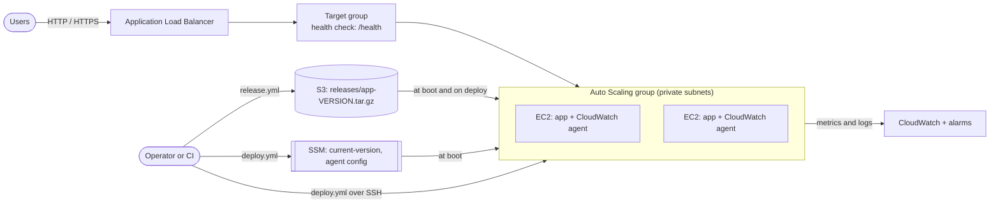

# aws-asg-alb-platform

Terraform and Ansible for running a stateless web service on EC2 behind an
Application Load Balancer:

- an **Auto Scaling group** across private subnets, scaling on CPU (and
  optionally ALB requests per target), with instance refresh for AMI and
  launch template changes
- **versioned releases** in S3, with an SSM parameter pointing at the live one,
  so any instance the group launches boots the current release
- an **Ansible rolling deploy** that drains each instance from the target
  group, installs the release, checks it, puts it back, and rolls the instance
  back if the new release fails
- the **CloudWatch agent** shipping memory and disk metrics and logs, plus
  alarms for unhealthy targets, 5xx responses and memory pressure

The app in `app/` is a small standard-library Python service with `/` and
`/health` endpoints, so the infrastructure and deploy flow can be exercised
end to end.

## Architecture



## Layout

```
app/                     demo service (Python 3.7+, no dependencies)
terraform/
  alb.tf                 load balancer, target group, HTTP/HTTPS listeners
  asg.tf                 launch template and Auto Scaling group
  scaling.tf             target tracking policies
  artifacts.tf           release bucket and current-version parameter
  cloudwatch.tf          agent config, log groups, alarms
  iam.tf                 instance role
  security_groups.tf     ALB -> instances only, SSH from listed CIDRs
  templates/             instance user data
ansible/
  release.yml            package app/ and publish it to S3
  deploy.yml             rolling deploy across the ASG
  resume_asg.yml         hand control back to the ASG after an aborted deploy
  roles/app_release/     per-instance install, verify and rollback
  inventory/aws_ec2.yml  dynamic inventory of the running fleet
scripts/
  export-terraform-outputs.sh
```

## Requirements

- Terraform 1.6 or newer (CI uses 1.17) and AWS credentials
- A VPC with public subnets in two or more AZs for the ALB, and private subnets
  with outbound access (NAT gateway or VPC endpoints for SSM, S3 and
  CloudWatch) for the instances
- For deploys: Ansible core 2.15+, `boto3`, the AWS CLI v2, an EC2 key pair and
  a network path to the private subnets (bastion or VPN)

## Getting started

```bash
cd terraform
cp terraform.tfvars.example terraform.tfvars   # VPC, subnets, key pair, SSH CIDRs
terraform init
terraform apply

cd ..
./scripts/export-terraform-outputs.sh          # writes ansible/group_vars/all/terraform.yml

cd ansible
ansible-galaxy collection install -r requirements.yml
ansible-playbook release.yml -e release_version=0.1.0
```

New instances look up the current version and keep retrying the download for
about five minutes, so publish the first release (matching
`initial_release_version`, `0.1.0` by default) right after the first apply.
Then:

```bash
curl "$(terraform -chdir=terraform output -raw app_url)"
# {"version": "0.1.0", "host": "ip-10-0-1-23...", "uptime_seconds": 42}
```

If you changed `region`, `project` or `environment`, update the filters in
`ansible/inventory/aws_ec2.yml` to match. If the instances are only reachable
through a bastion, set `ansible_ssh_common_args` in
`ansible/group_vars/all/main.yml`.

## Releasing and deploying

```bash
cd ansible
ansible-playbook release.yml -e release_version=0.2.0
ansible-playbook deploy.yml  -e release_version=0.2.0

# bigger batches for bigger fleets
ansible-playbook deploy.yml -e release_version=0.2.0 -e deploy_batch_size=25%
```

`release.yml` stamps a `VERSION` file into the package and uploads
`releases/app-0.2.0.tar.gz`. It refuses to overwrite an existing version:
releases are immutable, which is what makes rollbacks safe.

`deploy.yml` then:

1. checks the release exists and points the SSM version parameter at it, so an
   instance launched mid-rollout boots the new release
2. suspends the ASG's `HealthCheck`, `ReplaceUnhealthy`, `AZRebalance`,
   `AlarmNotification` and `ScheduledActions` processes, so the group doesn't
   replace an instance that is drained or restarting, or scale in mid-batch
3. for each batch of instances (one at a time by default):
   deregisters the instance and waits for connections to drain, downloads and
   unpacks the release next to the old ones, switches the `current` symlink,
   restarts the service, waits for `/health` and checks `/` reports the new
   version, then registers the instance and waits until the ALB sees it healthy
4. resumes the ASG processes

Instances already running the requested version are skipped, so re-running a
deploy is safe. Each instance keeps its last three releases on disk.

### When a release fails

If the new release doesn't come up healthy on an instance, that instance is
switched back to its previous release and returned to the target group, the
version parameter is pointed back at the previous release, ASG processes are
resumed, and the run stops before touching more instances. Instances from
earlier batches stay on the new release until you deploy again: either the
previous version, to roll the fleet back, or a fixed one.

If a run dies for another reason (lost SSH connection, expired credentials),
re-run it, or run `ansible-playbook resume_asg.yml` to give control back to
the ASG.

### Permissions for whoever deploys

`ec2:DescribeInstances`; `s3:ListBucket` and `s3:PutObject` on the release
bucket; `ssm:PutParameter` on the version parameter;
`autoscaling:SuspendProcesses` and `autoscaling:ResumeProcesses` on the group;
`elasticloadbalancing:RegisterTargets`, `DeregisterTargets` and
`DescribeTargetHealth` on the target group.

## Infrastructure changes vs app releases

App releases go through Ansible. Changes to the launch template (AMI, instance
type, user data) create a new template version, and the group's instance
refresh replaces instances in a rolling fashion while keeping at least half of
them in service. Avoid running a deploy and an instance refresh at the same
time.

To move to Graviton, set `architecture = "arm64"`: the AMI lookup switches to
the arm64 Amazon Linux 2023 image and the default instance type to
`t4g.small`. The app is pure Python, so it runs unchanged.

## Scaling

- Target tracking on average CPU (`cpu_target_value`, 60% by default).
- Optional target tracking on ALB requests per target
  (`requests_per_target`), for services where CPU lags behind traffic. With
  both, the group scales out on whichever asks for more capacity.
- Detailed (1-minute) monitoring is on by default so scaling reacts faster.
- Terraform ignores `desired_capacity` after creation, so an apply doesn't
  undo scaling.

## Observability

The agent configuration lives in an SSM parameter
(`AmazonCloudWatch-<project>-<environment>`), and instances load it at boot.

| What | Where |
|------|-------|
| Memory and root-disk usage | namespace `<project>/<environment>`, per instance and per ASG |
| Application logs | log group `/<project>/<environment>/app` |
| Bootstrap logs (cloud-init) | log group `/<project>/<environment>/bootstrap` |
| Alarms | unhealthy targets (3 min), target 5xx count, fleet memory |

Set `alarm_sns_topic_arn` to get notified. After changing the agent
configuration, push it to running instances with Run Command:

```bash
aws ssm send-command \
  --document-name AmazonCloudWatch-ManageAgent \
  --targets "Key=tag:aws:autoscaling:groupName,Values=$(terraform -chdir=terraform output -raw asg_name)" \
  --parameters '{"action":["configure"],"mode":["ec2"],"optionalConfigurationSource":["ssm"],"optionalConfigurationLocation":["AmazonCloudWatch-webapp-dev"],"optionalRestart":["yes"]}'
```

## Security

- Instances only accept app traffic from the ALB's security group, and SSH
  only from `ssh_ingress_cidrs` (empty by default).
- IMDSv2 is required, root volumes are encrypted gp3, and the ALB drops
  invalid headers.
- Instance permissions are limited to reading releases, the version
  parameter, and what SSM and the CloudWatch agent need.
- The release bucket blocks public access, is versioned and encrypted.
- With `certificate_arn` set, port 80 only redirects to HTTPS
  (TLS 1.2+ policy).

## Outputs

`app_url`, `alb_dns_name`, `asg_name`, `target_group_arn`, `artifact_bucket`,
`version_parameter`, `app_log_group`, `cloudwatch_agent_config_parameter`,
`launch_template_id`, `region`.

## Cost and cleanup

The main costs are the ALB, the instances (two `t3.small` by default), any NAT
gateway in your VPC, detailed monitoring, the agent's custom metrics and log
ingestion. Tear everything down with:

```bash
terraform -chdir=terraform destroy
```

Outside `prod`, the release bucket is deleted with its contents.
